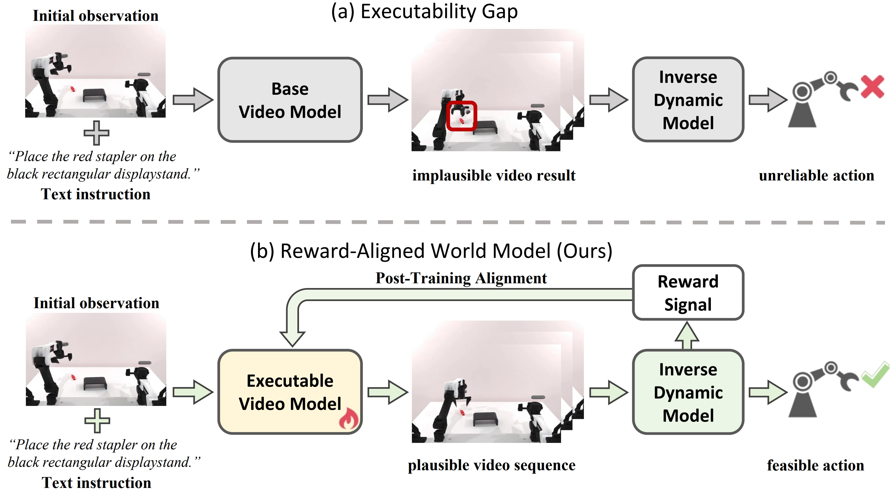

<h1 align="center">EVA: Aligning Video World Models with Executable Robot Actions via Inverse Dynamics Rewards</h1>


<p align="center">
  <a href="https://arxiv.org/abs/2603.17808"></a>
  <a href="https://eva-project-page.github.io/"></a>
  <a href="https://huggingface.co/RobbinWang123/EVA"></a>
</p>

<p align="center">
  
</p>

## Table of Contents

- [Overview](#-overview)
- [Release Progress](#release-progress)
- [Model Download](#model-download)
- [Installation](#installation)
- [Inference](#inference)
- [Training](#training)
  - [Supervised Fine-Tuning on Robotwin](#supervised-fine-tuning-on-robotwin)
  - [Inverse Dynamics Model Training](#inverse-dynamics-model-training)
  - [GRPO-Based Post-Training](#grpo-based-post-training)
- [Acknowledgments](#-acknowledgments)
- [Citation](#-citation)


## 💫 Overview

EVA is a post-training framework for aligning video world models with physically executable robot actions.

Recent work explores video generative models as visual planners for robotic manipulation. However, these models often produce rollouts that violate rigid-body and kinematic consistency, producing unstable or infeasible control commands when decoded by an inverse dynamics model. We refer to this mismatch between visual generation and physically executable control as the executability gap.

We introduce **Executable Video Alignment (EVA)**, a reinforcement-learning post-training framework for aligning video world models. EVA trains an inverse dynamics model on real robot trajectories and repurposes it as a reward model that evaluates generated videos through the action sequences they induce, encouraging smooth motions measured by velocity, acceleration, and jerk while penalizing actions that violate embodiment constraints.


## Release Progress

- [x] Inference code
- [x] Video world model checkpoint
- [x] Supervised fine-tuning code
- [x] RL post-training code

---
## Model Download

### EVA Checkpoint


You can download the EVA checkpoint fine-tuned on RoboTwin with:

```bash
huggingface-cli download RobbinWang123/EVA \
  --include "eva_i2v_14B.ckpt" \
  --local-dir ./data/ckpts
```

You can also download the IDM checkpoint used for inverse-dynamics reward modeling with:

```bash
huggingface-cli download RobbinWang123/EVA \
  --include "IDM_singleview.pt" \
  --local-dir ./data/ckpts
```

### Wan 2.1 Pretrained Checkpoint

This codebase uses the **Wan 2.1 Image-to-Video 14B** model as the base model.

Please follow the official Wan release for the latest instructions:

- https://github.com/Wan-Video/Wan2.1

Example download command:

```bash
huggingface-cli download Wan-AI/Wan2.1-I2V-14B-480P \
  --local-dir ./data/ckpts/Wan2.1-I2V-14B-480P
```

The downloaded directory should include the diffusion model, VAE, text encoder, and CLIP encoder.


## Installation


```bash
# Clone the repository
git clone https://github.com/RobbinW/EVA.git
cd EVA

# Create conda environment
conda create -n eva python=3.10
conda activate eva

# Install dependencies
pip install -r requirements.txt

# Install Flash Attention
# This may take several minutes to compile
pip install flash-attn --no-build-isolation
```

## Inference


### Example Inference Command

```bash
CUDA_VISIBLE_DEVICES=0 python -m main \
  +name=demo_infer \
  experiment=exp_inference \
  algorithm=wan_i2v \
  dataset=image_csv \
  dataset.data_root=data/test_images \
  dataset.metadata_path=metadata.csv \
  dataset.height=480 \
  dataset.width=640 \
  algorithm.model.tuned_ckpt_path=/path/to/EVA/data/ckpts/eva_i2v_14B.ckpt \
  algorithm.hist_guidance=1.5 \
  algorithm.lang_guidance=2.5 \
  algorithm.logging.video_type=single
```

Generated videos will be saved to:

```bash
outputs/<date>/<time>/videos/
```

### Notes

- `algorithm.model.tuned_ckpt_path` should point to the EVA fine-tuned checkpoint.
- The Wan base checkpoint paths can be set in `configurations/algorithm/wan_i2v.yaml`.
- `algorithm.hist_guidance` and `algorithm.lang_guidance` control the classifier-free guidance (CFG) scales for image (history) and language conditioning during inference.


## Training

### Supervised Fine-Tuning on Robotwin

We recommend placing RoboTwin and EVA under the same workspace:

```text
$WORKSPACE
├── RoboTwin
│   └── data
└── EVA
    └── data/ckpts
```

Before SFT, first prepare RoboTwin data by following the official RoboTwin installation
and data collection documentation:

- RoboTwin installation doc: [`https://robotwin-platform.github.io/doc/usage/robotwin-install.html`](https://robotwin-platform.github.io/doc/usage/robotwin-install.html)
- RoboTwin usage doc: [`https://robotwin-platform.github.io/doc/usage/index.html`](https://robotwin-platform.github.io/doc/usage/index.html)

In our setting, we move the camera backward to obtain a wider view of the workspace. You may refer to [https://github.com/thu-ml/vidar-robotwin](https://github.com/thu-ml/vidar-robotwin) for an example of modifying the embodiment camera position.


After collection, your dataset should live under:

```bash
$WORKSPACE/RoboTwin/data
```

Then switch back to `$WORKSPACE/EVA`. The commands below assume your current
directory is this repository root.

1. Generate `robotwin_videos.csv` from RoboTwin videos and instruction files:

```bash
python datasets/generate_robotwin_csv.py \
  --root-dir $WORKSPACE/RoboTwin/data \
  --output-csv $WORKSPACE/RoboTwin/data/robotwin_videos.csv
```


2. Cache the prompt embeddings referenced by `robotwin_videos.csv`:

```bash
CUDA_VISIBLE_DEVICES=0 python main.py \
  +name=process_robotwin_embeds \
  experiment=process_data \
  dataset=robotwin \
  dataset.data_root=$WORKSPACE/RoboTwin/data \
  dataset.metadata_path=robotwin_videos.csv \
  algorithm=wan_i2v \
  algorithm.text_encoder.ckpt_path=./data/ckpts/Wan2.1-I2V-14B-480P/models_t5_umt5-xxl-enc-bf16.pth \
  experiment.tasks=[cache_prompt_embed] \
  experiment.new_data_root=$WORKSPACE/RoboTwin/data \
  experiment.cache_prompt_embed.batch_size=16
```

This command saves prompt embeddings as `*.pt` files alongside each RoboTwin video, and updates `robotwin_videos.csv` in place with the `prompt_embed_path` column used by training.


3. Download the released Large Video Planner backbone checkpoint:

```bash
mkdir -p ./data/ckpts

aria2c -x 16 -s 16 -c -k 1M \
  -d ./data/ckpts \
  -o lvp_14B.ckpt \
  https://hf-mirror.com/KempnerInstituteAI/LVP/resolve/main/checkpoints/lvp_14B.ckpt
```

This produces:

```bash
./data/ckpts/lvp_14B.ckpt
```

4. Start SFT:

```bash
accelerate launch main.py \
  +name=final_i2v \
  experiment=exp_video \
  algorithm=wan_i2v \
  dataset=robotwin \
  dataset.data_root=$WORKSPACE/RoboTwin/data \
  dataset.metadata_path=robotwin_videos.csv \
  experiment.num_nodes=1 \
  algorithm.lang_guidance=0 \
  algorithm.hist_guidance=0 \
  experiment.training.batch_size=1 \
  algorithm.gradient_checkpointing_rate=1.0 \
  algorithm.model.tuned_ckpt_path=./data/ckpts/lvp_14B.ckpt
```

Checkpoints will be saved under:

```bash
outputs/<date>/<time>/checkpoints/
```

### Inverse Dynamics Model Training

`EVA` includes IDM training. The IDM dataset reads raw RoboTwin HDF5 trajectories
from the configured RoboTwin task variant:

```text
$WORKSPACE/RoboTwin/data/<task>/<task_config>/data/*.hdf5
```

IDM training uses the head camera view (`observation/head_camera/rgb`). The default config is at `configurations/dataset/robotwin_idm.yaml`.

Example command:

```bash
CUDA_VISIBLE_DEVICES=0 accelerate launch main.py \
  +name=idm_train \
  experiment=exp_idm \
  algorithm=idm_resnet_plus \
  dataset=robotwin_idm \
  dataset.data_root=$WORKSPACE/RoboTwin/data
```


IDM checkpoints are saved to:

```bash
outputs/<date>/<time>/checkpoints/
```

Each checkpoint keeps the legacy-compatible structure:

- `model_state_dict`
- `optimizer_state_dict`
- `step`

### GRPO-Based Post-Training

`EVA` also includes the Flow-GRPO post-training path used for executable video
alignment.

The RL experiment is configured by:

- `configurations/experiment/exp_flow_grpo.yaml`

RL post-training uses the inverse-dynamics smoothness reward and requires an explicit IDM checkpoint:

- `experiment.training.reward_model_path=./outputs/<date>/<time>/checkpoints/best.pt`


Example command:

```bash
accelerate launch main.py \
  +name=rl_debug_test \
  experiment=exp_flow_grpo \
  algorithm=wan_i2v \
  dataset=robotwin \
  dataset.data_root=$WORKSPACE/RoboTwin/data \
  dataset.metadata_path=robotwin_videos.csv \
  experiment.num_nodes=1 \
  experiment.training.batch_size=1 \
  experiment.training.reward_model_path=./outputs/<date>/<time>/checkpoints/best.pt \
  algorithm.model.use_lora=True \
  algorithm.model.lora_rank=32 \
  algorithm.lang_guidance=0 \
  algorithm.hist_guidance=0 \
  algorithm.gradient_checkpointing_rate=1.0
```

The RL experiment saves:

- Accelerate training state under `outputs/<date>/<time>/checkpoints/`
- LoRA adapters under `outputs/<date>/<time>/checkpoints/<epoch-step>/lora_adapter/`
- Reward visualization plots under `outputs/<date>/<time>/idm_plots/`

---


## 🧩 Acknowledgments

We thank the authors of the following open-source projects for their valuable contributions:

- [large-video-planner](https://github.com/buoyancy99/large-video-planner/tree/main)
- [Wan2.1](https://github.com/Wan-Video/Wan2.1)
- [flow-grpo](https://github.com/yifan123/flow_grpo)


## 📚 Citation

If you find our work helpful, please cite:

```bibtex
@misc{wang2026evaaligningvideoworld,
  title={EVA: Aligning Video World Models with Executable Robot Actions via Inverse Dynamics Rewards},
  author={Ruixiang Wang and Qingming Liu and Yueci Deng and Guiliang Liu and Zhen Liu and Kui Jia},
  year={2026},
  eprint={2603.17808},
  archivePrefix={arXiv},
  primaryClass={cs.RO},
  url={https://arxiv.org/abs/2603.17808}
}
```

